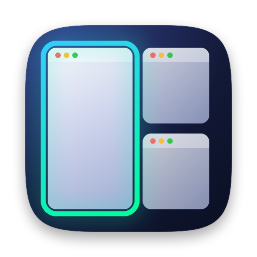

# MarSpace

MarSpace is a tiling window manager for macOS. Windows are laid out side by side automatically, and you move between
them and between workspaces with the keyboard, or just by moving the mouse.

MarSpace is built on [AeroSpace](https://github.com/nikitabobko/AeroSpace) by Nikita Bobko and its contributors
(MIT license, see [LICENSE.txt](./LICENSE.txt)). It keeps AeroSpace's tree of windows, its emulated workspaces (no
need to disable SIP) and its `aerospace` CLI, and replaces the config file with a settings window.

## Highlights

- **Settings window instead of a config file.** Shortcuts, window rules, workspaces, gaps, the focus border and
  automation, all edited in a native window. Changes apply right away, and invalid ones are shown where they are and
  never applied. On the first launch, an existing `~/.aerospace.toml` is imported once, nothing of it is lost.
- **Shortcuts that know your keyboard.** Shortcuts are recorded by their physical keys and shown with the labels of
  your keyboard layout (QWERTY, QWERTZ, AZERTY, Dvorak, …). Actions are picked from menus; any `aerospace` command is
  still possible as a custom action.
- **One rule for all workspace shortcuts.** For example ⌃⌥ plus the workspace's key goes there, ⌃⌥⇧ moves the window
  there, for every workspace named with one key.
- **Window rules with an app picker.** For example "Terminal opens a window: move it to workspace T".
- **Dwindle and balanced placement.** A new window splits the focused or the largest window, like Hyprland.
- **Focus border.** A solid or gradient border around the focused window, following its real frame, also when an app
  refuses to shrink to its tile.
- **Focus follows the mouse.** It also works where windows overlap and when the focus changed by the keyboard.
- **Windows stay where they belong.** After a restart, windows return to their workspaces. After fullscreen, minimize
  or hide, they return to their place in the layout.
- **Menu bar panel** with the workspaces and their apps.
- **Fast and light.** Only changed window frames are sent to apps, the settings window keeps its panes, and the
  settings file is checksummed, written atomically and backed up.

## Building

MarSpace is built from source (Xcode 27, Swift 6.4):

```
./build-release.sh --codesign-identity <your code signing identity>
```

See [dev-docs/development.md](./dev-docs/development.md) for the development setup. On the first launch, macOS asks
for the Accessibility permission: MarSpace can't move windows without it.

## Compatibility

The bundle id (`bobko.aerospace`) and the CLI (`aerospace`) are the same as AeroSpace's, so scripts keep working. The
CLI commands are documented in the [AeroSpace command reference](https://nikitabobko.github.io/AeroSpace/commands). Don't
run MarSpace and AeroSpace at the same time.

## Credits and license

MarSpace is MIT licensed, like AeroSpace, on which it is based. Thanks to Nikita Bobko and all contributors of
[AeroSpace](https://github.com/nikitabobko/AeroSpace).
